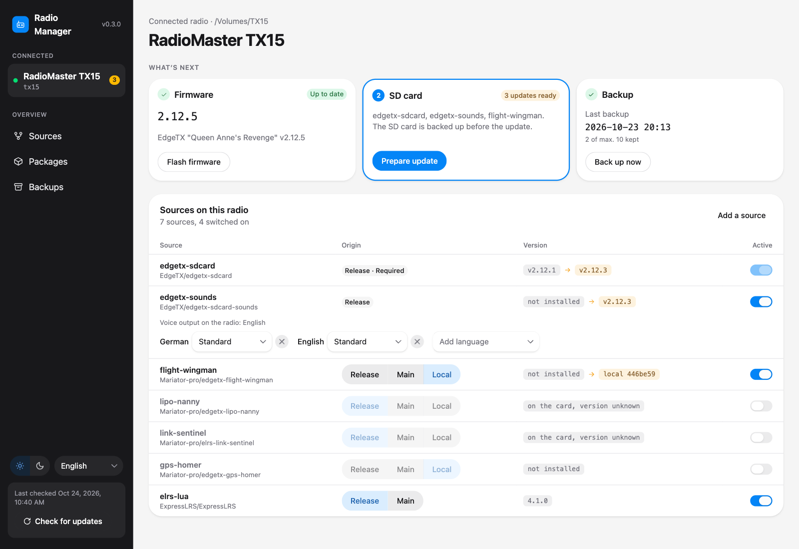
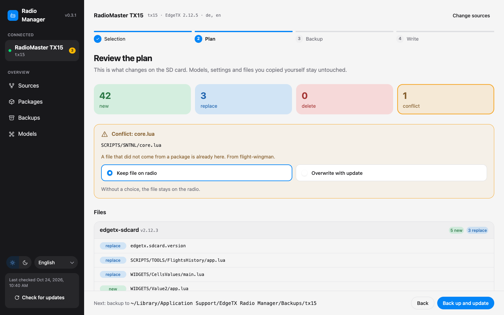
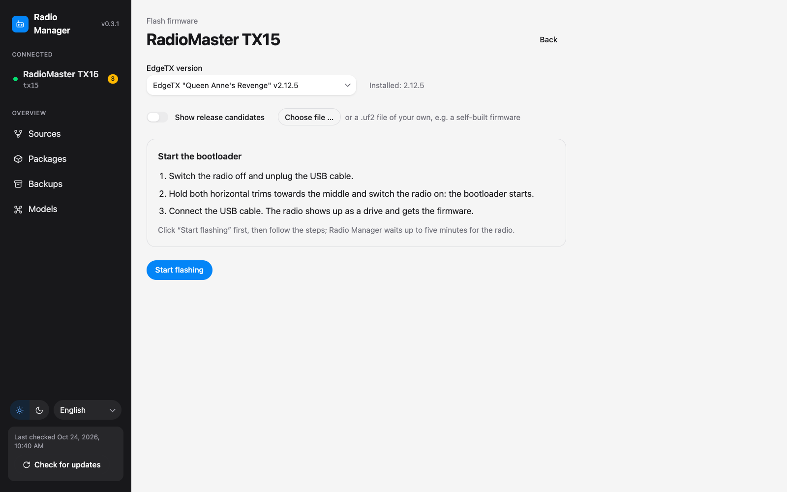
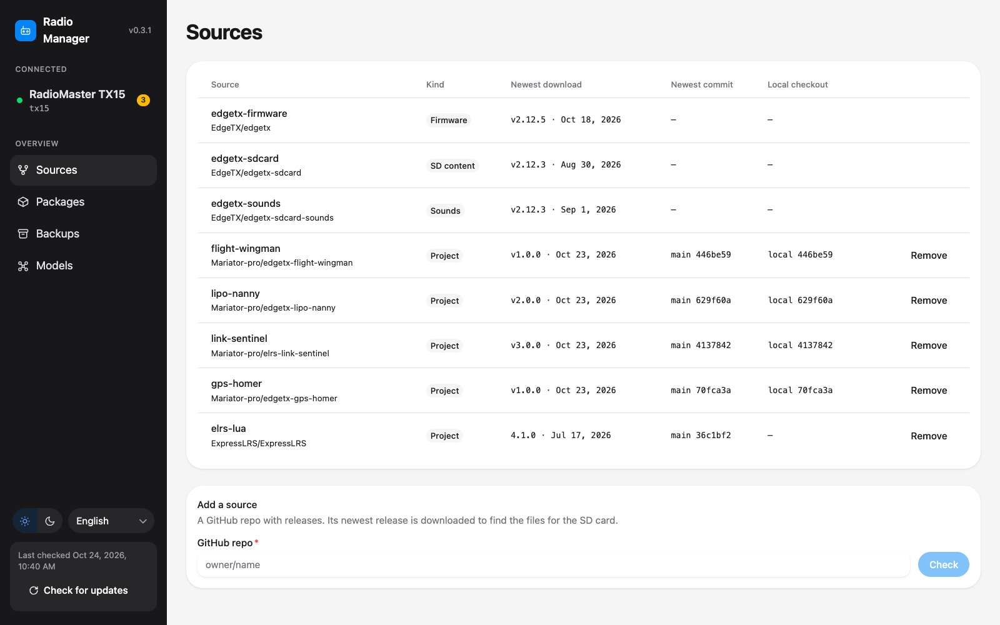
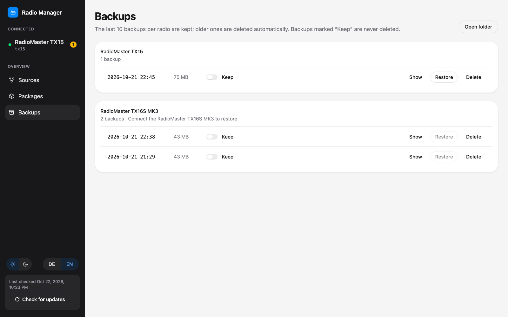

# EdgeTX Radio Manager

Keep your EdgeTX radio up to date without copying files by hand. Plug in the radio, and the app shows what is new: firmware, SD card content, voice packs and your Lua scripts and widgets from GitHub. It backs up the SD card before every change and never silently overwrites files you changed yourself.

Desktop app for macOS, Windows and Linux, in twelve languages (English by default, the others in a menu at the bottom of the sidebar). A browser interface and a command line tool are included as well.



## What it does

- **Detects your radio** as soon as it is connected in "USB Storage" mode: radio type, language, firmware and what is installed on the SD card.
- **Downloads updates** from GitHub: EdgeTX firmware, the EdgeTX SD card content, voice packs, the ExpressLRS Lua script and any Lua project you add.
- **Updates the SD card** in one guided flow: shows exactly which files are added, replaced or deleted, backs up the card, then writes the changes.
- **Flashes firmware**, with step by step instructions for entering the bootloader.
- **Keeps backups** of the whole SD card, the last 10 per radio by default, and any backup you mark to keep, and restores them when needed.

Every radio that EdgeTX supports works: radio types and SD card content come straight from the EdgeTX release.

## Install

Download the app from the [Releases](https://github.com/Mariator-pro/edgetx-radio-manager/releases) page:

- **macOS**: `edgetx-radio-manager-macos-arm64-v<version>.zip` for Apple Silicon (M1 and newer) or `edgetx-radio-manager-macos-x64-v<version>.zip` for Intel Macs. Unzip it, open the `.dmg` inside and drag the app into Applications.
- **Windows**: `edgetx-radio-manager-win64-v<version>.zip`. Unzip it and run the installer inside.
- **Linux** (x64): `edgetx-radio-manager-linux-v<version>.zip`. Unzip it and start the `.AppImage` inside, for example with a double click or `./edgetx-radio-manager-linux-v<version>.AppImage`. If it does not start, the system may lack FUSE 2: on Ubuntu 24.04 and newer install it with `sudo apt install libfuse2t64`, on older Ubuntu and Debian with `sudo apt install libfuse2`.

The app is not signed with an Apple or Microsoft certificate, so the system warns on first start:

- **macOS**: the first start shows "Apple could not verify ... is free of malware". Click "Done" (not "Move to Trash"), open System Settings, Privacy & Security, scroll down and click "Open Anyway" next to the blocked app, confirm with your password or Touch ID, then start the app again and choose "Open". Later starts need nothing.
- **Windows**: if a SmartScreen window appears, click "More info" and then "Run anyway".
- **Linux**: no warning. If the file manager does not start the AppImage, mark it as executable (`chmod +x`).

### Only for radios that flash over DFU

Radios with a UF2 bootloader (for example RadioMaster TX15 and TX16S Mk III) get their firmware through a USB drive in the bootloader and need nothing extra. Others such as the TX16S flash over USB DFU and need [`dfu-util`](https://dfu-util.sourceforge.net/), which is not bundled. The app tells you when your radio needs it and blocks flashing until it is installed:

- macOS: `brew install dfu-util`
- Windows: download `dfu-util` and put it in the `PATH`, and install the WinUSB driver for the radio in DFU mode with [Zadig](https://zadig.akeo.ie/)
- Linux: install it with the package manager, e.g. `sudo apt install dfu-util`, and allow access to the radio in DFU mode without root with a udev rule:

  ```sh
  echo 'SUBSYSTEMS=="usb", ATTRS{idVendor}=="0483", ATTRS{idProduct}=="df11", MODE="0664", TAG+="uaccess"' | sudo tee /etc/udev/rules.d/45-edgetx-dfu.rules
  sudo udevadm control --reload-rules
  ```

## Using it

### 1. Connect the radio

Switch the radio on, plug in the USB cable and choose "USB Storage" on the radio. The app opens the radio's page. It shows three cards in the order they are due: firmware, SD card and backup.

Below them you choose what belongs on this radio: switch sources on or off, and for your own projects pick where they come from (see [Where packages come from](#where-packages-come-from)). The voice packs are chosen per language on the right.

### 2. Check for updates

"Check for updates" at the bottom left looks for new releases of all sources and downloads them. Downloaded versions stay on your computer, so updating works offline later.

### 3. Update the SD card

"Prepare update" shows the plan before anything is written: how many files are new, replaced or deleted, and every file per package.



Files that you changed on the card, or that did not come from a package, show up as **conflicts**. You decide per file whether to keep it or overwrite it; without a choice it stays. Models, settings and files you copied yourself are never touched.

"Back up and update" first copies the whole card into a backup, then writes the changes.

### 4. Flash firmware

"Flash firmware" on the firmware card opens the flash page. Pick the EdgeTX version (the newest downloaded one is preselected), click "Start flashing" and follow the steps to put the radio into its bootloader. The app waits up to five minutes for the radio. Afterwards, run an SD card update so the card matches the new firmware.

The list also shows the older EdgeTX versions from 2.12 on that have a file for your radio, also those not downloaded yet. To find them the app reads only the end of each firmware zip on GitHub, a few KB, and remembers the result. A version that is not downloaded yet is downloaded when you click "Start flashing", and then stays like any other download. "Check for updates" itself only downloads the newest firmware.

Two more options sit below the version list:

- **Show release candidates**: also lists the test versions EdgeTX publishes before a release (e.g. `v2.12.0-rc4`), from 2.12 on. Like the older versions they are downloaded when you flash one. The newest finished release stays preselected, and the SD content stays at the newest release.
- **Choose file**: flashes a `.uf2` or `.bin` file of your own, e.g. a firmware you built yourself. The app reads the radio type and version that EdgeTX builds into every firmware and refuses a file for another radio or of the wrong kind. A file without this identification can only be flashed after ticking "Flash it anyway".



### 5. Add your own Lua scripts and widgets

On the "Sources" page, enter a GitHub repo (`owner/name`) and click "Check". The app looks for the folder with `SCRIPTS/` or `WIDGETS/` in its newest release and shows it for you to confirm. Added sources can be removed again; EdgeTX firmware, SD content and sounds are built in.



### 6. Restore or keep backups

The "Backups" page lists the backups per radio. Below each one it shows the EdgeTX version on the card at the time and why the backup was made: by hand, before restoring another backup, or before an SD update together with the packages that update changed. "Note" adds your own short text. Switch on "Keep" for a backup that should never be deleted, for example before a big EdgeTX upgrade. "Open folder" shows the backups on your computer, for example to copy a single model back by hand.

"Restore" brings the SD card back to exactly the state of that backup: changed and missing files come back, files added since then are deleted. It works only while a radio of the same type is connected. Before anything is written, the app shows the plan with every file, and points out when the backup was made with a different EdgeTX version than the one on the radio. "Back up the SD card first" is on by default, so a restore can be undone as well.



The "Packages" page lists every downloaded version. Nothing there is deleted automatically, and versions installed on a radio cannot be deleted.

## Where packages come from

For every radio the app stores which sources go on the card and where they come from:

- **Release**: the newest downloaded GitHub release
- **Main**: the newest commit of the main branch (own projects only), downloaded when needed
- **Local**: a local git checkout. Checkouts of the projects next to this repo (e.g. `../edgetx-lipo-nanny`) are found automatically when the tool runs from source.

What was installed on the card is recorded in `.radio-manager/installed.json` on the SD card. On the next update the app uses it to tell which files it wrote itself and which were changed since.

## Your data on the computer

Settings, downloads and backups live where apps keep their data on each system:

- macOS: `~/Library/Application Support/EdgeTX Radio Manager/`
- Windows: `%LOCALAPPDATA%\EdgeTX Radio Manager\` (e.g. `C:\Users\<name>\AppData\Local\EdgeTX Radio Manager`), not Roaming, because downloads and backups are large
- Linux: `~/.local/share/edgetx-radio-manager/` (or `$XDG_DATA_HOME`)

```
EdgeTX Radio Manager/
├── settings.json          sources, radios, backup settings
├── Packages/<source>/     downloaded versions, _main/ for the main branch
└── Backups/<board>/       one folder per backup, named by date and time
```

On macOS the desktop app keeps its window data (language, theme) in the same folder, on Windows next to it in `%APPDATA%\EdgeTX Radio Manager\`, on Linux in `~/.config/EdgeTX Radio Manager/`.

## Running from source

Needs Node.js 22.18 or newer (TypeScript runs directly, without a build step for the command line). Drive detection works on macOS, Windows and Linux (there: FAT and exFAT drives listed in `/proc/mounts`).

```sh
git clone https://github.com/Mariator-pro/edgetx-radio-manager.git
cd edgetx-radio-manager
npm install
npm run build   # builds the browser interface into dist/ui, the desktop main process into dist/desktop and THIRD_PARTY_LICENSES.txt
```

### Browser interface

```sh
npm start
```

Starts the server on `http://127.0.0.1:5174` and opens the browser, with the same pages as the desktop app.

### Command line

```sh
npm run cli -- <command> [options]
```

| Command | What it does |
| --- | --- |
| `status` | Connected radio, installed and downloaded versions |
| `download` | Check all sources for new releases and download them |
| `backup` | Back up the whole SD card of the connected radio |
| `update` | Show the plan, then back up and update the card |
| `restore [backup]` | Without a name, list the backups of the connected radio with EdgeTX version, reason and note; with one (e.g. `restore 2026-10-23_2015`), show the plan, then back up the card and restore the backup |
| `flash [version]` | Flash firmware, without a version the newest downloaded one; any other release is downloaded first (e.g. `flash v2.12.2` or `flash v2.12.0-rc4`); `flash --file <path>` flashes a `.uf2` or `.bin` of your own |
| `sources` | List sources; `sources add <owner/repo>`, `sources remove <name>` |
| `ui` | Open the browser interface (like `npm start`) |

Options:

- `--volume <path>`: use this drive instead of automatic detection
- `--board <id>`: radio type when the card has no `RADIO/radio.yml` yet (e.g. `tx16s`)
- `--no-backup`: restore without backing up the card first
- `--force`: with `flash --file`, flash a file that has no EdgeTX identification

Typical flow: `download`, connect the radio in "USB Storage" mode, `update`.

### Desktop app

```sh
npm run desktop   # builds everything and starts the app
npm run dist      # builds the installers for your own system into release/
```

The app starts the server itself (port 5175) and shows the interface in its own window; links to GitHub open in the browser. The licenses of the bundled open source packages are in `THIRD_PARTY_LICENSES.txt` in the app's resources folder, next to Electron's own license files.

A new release is made with a tag: bump the version in `package.json`, then `git tag v0.2.0 && git push origin v0.2.0`. The GitHub workflow `.github/workflows/release.yml` builds the app for macOS and Windows and attaches the files to the release.

## Development

```sh
npm run dev        # Vite with API server, interface with hot reload
npm test           # Vitest
npm run typecheck  # TypeScript for core and interface
npm run lint       # oxlint
```

To test without a real radio, `RADIO_MANAGER_VOLUMES` can point to one or more folders (separated like in the `PATH`), for example the SD folder of a simulator.

How it works under the hood:

- **Detection**: the radio type, language and firmware are read from the SD card (`RADIO/radio.yml`, `edgetx.sdcard.version`).
- **Download**: new releases of all sources from GitHub, and for own projects also the newest commit of the main branch.
- **Backup**: copies the whole SD card, including file times, into a folder; old backups are pruned.
- **Restore**: compares the backup with the card by size and file time (small files also by content) and writes only what differs; files the backup does not have are deleted.
- **Update**: compares the packages with the card; files changed on the card come up as conflicts instead of being overwritten.
- **Firmware**: radios with a UF2 bootloader get the firmware via the drive, all others via USB DFU (`dfu-util`). The method follows from the firmware file for the radio type.

Structure:

- `src/core/`: logic (detection, download, backup, restore, update plan, firmware)
- `src/server/`: HTTP API and server-sent events for progress and state
- `src/ui/`: React interface (HeroUI, Tailwind)
- `src/cli/`: command line
- `src/desktop/`: Electron main process, starts the server and shows the interface in its own window
- `src/platform/`: drive detection, the only OS-specific part
- `scripts/licenses.ts`: collects the license texts of all bundled packages during the build
- `docs/screenshots/`: the screenshots in this README

## License

Released under the [MIT License](LICENSE). The app bundles open source packages under their own licenses, listed in `THIRD_PARTY_LICENSES.txt` (see [Desktop app](#desktop-app)).
